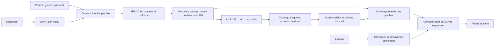

# Baseline protéine–ligand classique / quantique

Projet PyTorch modulaire, **sans Sparse Autoencoder**, utilisant ESM-2,
DeepChem/ChemBERTa-77M-MTR et PennyLane. Le code complet est dans les fichiers
ci-dessous. Commencer par Davis, puis comparer classique / quantique sur les
mêmes partitions avant de passer à KIBA ou BindingDB.

## 1. Architecture générale



Pour le patch `p_i`, `s_i = score(circuit(projection(p_i)))`,
`alpha_i = softmax(s)_i`, `h_P = somme(alpha_i * p_i)`.
Le pooling porte sur les patches de dimension 256, pas sur les mesures
quantiques. Les patches de remplissage sont masqués et jamais simulés.

## 2. Sources vérifiées et hypothèses de reproduction

Sources consultées et utilisées :

- [PocketDTA](https://github.com/BioCenter-SHU/PocketDTA), commit
  `0e03b353544129fac537321787a1b38aba6e0192`. Les tables sont
  `data/Davis/davis_datasets.csv` et `data/KIBA/kiba_datasets.csv`, avec
  `Target_ID`, `Target`, `Drug_ID`, `Drug`, `Y`, `PDB_File`.
  Davis contient des archives `pdb.zip` et `p2rank.zip`.
  Les objets originaux de ce dépôt sont des objets TorchDrug/GearNet ; les
  champs GVP `node_s/node_v/edge_s/edge_v` ne sont pas présumés présents.
- [BALM](https://github.com/meyresearch/BALM), code consulté au commit
  `c0a4ecb828c44ba1633e06e885da12c5a6ababd6`, et
  [BALM-benchmark](https://huggingface.co/datasets/BALM/BALM-benchmark),
  configuration `BindingDB_filtered`, split source `train`. Ce split HF
  désigne la table source, **pas** le split d'entraînement créé ici.
  Les noms de colonnes sont aussi `Target`, `Drug`, `Y`, etc.
  Le code BALM regroupe les doublons par maximum de `Y`.
- Encodeurs : [ESM-2](https://huggingface.co/facebook/esm2_t6_8M_UR50D) et
  [ChemBERTa-77M-MTR](https://huggingface.co/DeepChem/ChemBERTa-77M-MTR).
  Leurs révisions par défaut sont `c731040fcd8d73dceaa04b0a8e6329b345b0f5df`
  et `66b895cab8adebea0cb59a8effa66b2020f204ca`. Le benchmark BALM est
  épinglé à `84e07e27a093181ee89c97a0d7a45482803aa9bd`.

Les paramètres exacts de l'architecture de Fadoua et son protocole expérimental
n'ont pas été fournis. Ce projet est une baseline exécutable fondée sur votre
schéma, **pas une reproduction certifiée de ses résultats**. Choix explicites :

| Élément | Choix de cette baseline |
|---|---|
| ESM-2 | `esm2_t6_8M_UR50D` (320 dimensions) pour commencer ; configurable |
| Ligand | ChemBERTa-77M-MTR, 384 dimensions, moyenne sans tokens spéciaux |
| Backbones | Gelés par défaut, aucun SAE ; dégel configurable |
| Longues protéines | Chunks de 1000 résidus, concaténés sans troncature ; contexte interrompu aux frontières |
| Longs SMILES | Erreur explicite au-delà de la capacité ; aucune troncature silencieuse |
| Structure Davis | C-alpha et features P2Rank de la pocket de rang 1, pas l'encodeur GearNet original |
| Voisinages | Sphères de rayon 8 Å ; jusqu'à 32 ancres FPS, puis 8 patches sélectionnés |
| Graphe sans coordonnées | Groupes contigus de nœuds ; leur ordre n'est pas supposé être un ordre biologique |
| Sans structure | Fenêtres de 32 résidus ESM, couverture uniforme ; fallback séquentiel signalé |
| Alignement | `residue_index` zéro-based explicite ; pour PDB, correspondance de chaîne complète exacte uniquement |
| Alignement inconnu | Moyenne ESM globale dans chaque patch structural, jamais d'indices inventés |
| Vecteur structural | 10 valeurs : moyenne/std de node_s, normes node_v, edge_s, normes edge_v et degré interne |
| Patch fixe | LayerNorm et Linear/GELU de `(dim_ESM + 10)` vers 256 |
| Projection | MLP `256 → 64 → n_qubits`, GELU et dropout 0.1 |
| Circuit | 4 qubits, 2 couches `Rot` + anneau CNOT, `RY(pi*tanh(x))`, mesures Pauli-Z |
| RX/RY/RZ optionnel | Le même angle est appliqué aux trois axes ; ce ne sont pas trois angles indépendants |
| Variante classique | Même projection/pooling/tête ; petit MLP à la place du circuit |
| Fusion | Concaténation puis `640 → 256 → 64 → 1` avec l'ESM choisi par défaut |
| Splits | Splits locaux seedés, pas les folds publiés PocketDTA/BALM |
| Doubles enregistrements | Identité par séquence/SMILES ; moyenne Davis/KIBA, maximum BindingDB |

L'agrégation des alias change la population : 30 056 lignes Davis deviennent
25 772 paires uniques, et 118 254 lignes KIBA deviennent 117 657 paires uniques.
Cette décision évite de répartir la même entrée du modèle entre train et test,
mais empêche de comparer directement les métriques aux tables originales.
Les identités utilisent le texte SMILES exact : deux SMILES différents pour la
même molécule ne sont pas automatiquement canonicalisés. Un protocole de
généralisation chimique strict doit canonicaliser en amont avec une politique
RDKit explicitement choisie. Les splits froids ne garantissent pas non plus
l'absence de protéines homologues entre partitions.

Davis `Y` est déjà en pKd ; KIBA `Y` est un score KIBA ; BindingDB BALM est utilisé
sur son échelle pKd. Ne pas mélanger ces cibles. `--affinity-unit nM` est réservé
aux CSV personnalisés contenant de vrais Kd positifs en nM et applique
`pKd = 9 - log10(Kd_nM)`. Cette conversion est interdite pour KIBA.

## 3. Liste exacte des fichiers

```text
proteine-legand/
├── README.md
├── VALIDATION.md                 # preuves et limites de cette session
├── .gitignore
├── config.yaml
├── requirements.txt             # dépendances directes épinglées
├── requirements-cpu.lock         # versions transitives testées Linux/Python 3.12
├── prepare_data.py               # PocketDTA et BALM vers le schéma commun
├── prepare_embeddings.py         # caches des backbones gelés
├── train.py                      # AdamW, MSE, scheduler, early stopping, checkpoint
├── evaluate.py                   # évaluation du split enregistré
├── aggregate.py                  # mean ± std inter-seeds
├── src/
│   ├── __init__.py
│   ├── datasets.py               # splits, Dataset, DataLoader
│   ├── protein_encoder.py        # ESM-2, chunks, mean/résidus, gel et cache
│   ├── ligand_encoder.py         # ChemBERTa, gel et cache
│   ├── pocket_data.py            # adaptateur PDB/P2Rank explicite
│   ├── patch_encoder.py          # graphes, construction et encodage des patches
│   ├── patch_selection.py        # FPS et fallback uniforme
│   ├── quantum_layer.py          # QNode et TorchLayer différentiables
│   ├── model.py                  # projection, scoring, pooling, fusion
│   ├── metrics.py                # RMSE, MAE, Pearson, Spearman, CI
│   ├── engine.py                 # boucle commune et empreinte des données
│   └── utils.py                  # seeds, config, sauvegardes et shapes
├── scripts/
│   ├── setup_cloud.sh            # installation CPU répétable
│   ├── make_davis_smoke.py        # sous-ensemble réel pour test de fonctionnement
│   ├── smoke.py                   # optimisation classique/quantique hors réseau
│   ├── export_torchdrug.py        # export de pickles source de confiance
│   └── run_seeds.sh               # seeds 0,1,2,3,4 puis agrégation
└── tests/
    ├── test_pipeline.py
    └── test_encoders.py
```

Créés au fil des commandes, et ignorés par Git : `data/raw/`,
`data/processed/`, `data/smoke/`, `embeddings/`, `.cache/` et `runs/`.
Les données/poids volumineux ne sont pas inclus dans l'archive du code.

## 4. Installation exacte

Python 3.12 sous Linux est la configuration CPU testée. Python 3.10/3.11 devrait
convenir aux dépendances directes, mais n'a pas été validé ici.

Dans cet environnement cloud :

```bash
cd /workspace/proteine-legand
bash scripts/setup_cloud.sh
source /workspace/.venvs/proteine-legand/bin/activate
export PIP_CACHE_DIR=/workspace/.cache/pip
export HF_HOME=/workspace/proteine-legand/.cache/huggingface
export OMP_NUM_THREADS=2
```

Sur une autre machine, dans le dossier du projet (CPU) :

```bash
python3 -m venv .venv
source .venv/bin/activate
python -m pip install --index-url https://download.pytorch.org/whl/cpu 'torch==2.5.1'
python -m pip install -r requirements.txt -c requirements-cpu.lock
python -m pip check
python -m pytest -q
```

Pour une machine NVIDIA avec pilote compatible CUDA 12.1, utiliser un nouvel
environnement et **ne pas appliquer le verrou CPU** :

```bash
python3 -m venv .venv-cuda
source .venv-cuda/bin/activate
python -m pip install --index-url https://download.pytorch.org/whl/cu121 'torch==2.5.1'
python -m pip install -r requirements.txt
python -c 'import torch; print(torch.cuda.is_available())'
```

`device: auto` choisit CUDA si disponible. Le simulateur `default.qubit` reste
sur CPU ; les transferts conservent l'autograd. Aucun GPU n'était disponible
dans la session de validation, donc la voie CUDA n'est pas encore testée.
Les dépôts et poids utilisés sont publics : aucun token n'est requis en principe.
Respecter les licences des données et modèles en cas de redistribution.

## 5. Préparer Davis en premier

```bash
python prepare_data.py --dataset davis
python prepare_embeddings.py --dataset davis
```

La première commande clone PocketDTA dans `data/raw/PocketDTA`, choisit le
commit documenté, lit son CSV, construit les graphes C-alpha/P2Rank disponibles,
et écrit `data/processed/davis/pairs.csv` et `provenance.json`.
Une source locale existante est conservée : son commit réel est enregistré.

```bash
python prepare_data.py --dataset davis --source /chemin/vers/PocketDTA
```

Schéma commun :

```text
protein_id,ligand_id,sequence,smiles,affinity,graph_path
```

`graph_path` peut être vide, absolu ou relatif au CSV. Les IDs conservent la
provenance ; les splits froids utilisent les séquences et SMILES pour contrôler
les alias. Un graphe externe remplace l'adaptation PDB/P2Rank :

```bash
python prepare_data.py --dataset davis --graph-map /chemin/graph_map.json
# Ou une baseline volontairement séquentielle :
python prepare_data.py --dataset davis --sequence-only
```

`graph_map.json` associe les `Target_ID` sources aux fichiers `.pt`/`.npz`.
Ces fichiers contiennent uniquement des tenseurs/arrays : `coords` ou `pos`
`[N,3]` en Å ; facultativement `residue_index [N]`, `node_s [N,S]`,
`node_v [N,V,3]`, `edge_index [2,E]`, `edge_s [E,S_e]`, `edge_v [E,V_e,3]`.
Les features optionnelles manquantes donnent des résumés nuls. Les données
malformées ou les indices invalides déclenchent une erreur explicite, et ne
sont pas cachés par un fallback. Le chargeur n'exécute pas de pickles arbitraires.

Pour des objets TorchDrug prétraités déjà disponibles, exécuter dans leur
**environnement PocketDTA original** (où TorchDrug est installé) :

```bash
python scripts/export_torchdrug.py \
  --pickle /chemin/gearnet_pocket_Protein.pkl \
  --index-map /chemin/protein_indices.json \
  --output /chemin/tensor_graphs --trust-source
```

`protein_indices.json` associe les IDs aux indices de la liste source.
`graph_map.json` est généré dans le dossier de sortie. Le drapeau explicite
est nécessaire car un pickle Python peut exécuter du code ; n'utiliser que
vos fichiers source de confiance. Cet exporteur est fourni pour adaptation,
mais n'a pas été testé avec les pickles natifs absents de la session.
Ne pas déduire `residue_index` de la position d'un atome dans un objet TorchDrug.

## 6. Valider rapidement le pipeline

Tests indépendants du réseau et des données :

```bash
python -m pytest -q
python scripts/smoke.py --model classical
python scripts/smoke.py --model quantum
```

Les tests d'encodeurs utilisent de vrais petits modèles Transformers locaux
initialisés aléatoirement, uniquement pour vérifier chunks, cache, gel et
gradients. Les scripts smoke utilisent des embeddings synthétiques et vérifient
la diminution de MSE, les gradients, le softmax et la restauration des poids.
Ils ne mesurent aucune performance d'affinité.

Puis un test réel très court avec ESM/ChemBERTa préentraînés et pockets Davis :

```bash
python scripts/make_davis_smoke.py
python train.py --dataset davis --model classical --split random --config data/smoke/config.yaml
python train.py --dataset davis --model quantum --split random --config data/smoke/config.yaml
python train.py --dataset davis --model classical --split cold_both --config data/smoke/config.yaml
python train.py --dataset davis --model quantum --split cold_both --config data/smoke/config.yaml
python evaluate.py --checkpoint runs/davis_smoke/davis/classical/random/seed_0/best.pt
python evaluate.py --checkpoint runs/davis_smoke/davis/quantum/random/seed_0/best.pt
```

Ce sous-ensemble contient 96 paires sélectionnées pour leur petite taille, donc
est biaisé. Le test Cold-Both n'a que 2 exemples dans chacune des partitions
validation et test. **Ses métriques ne sont pas un résultat de benchmark.**
Un dossier d'expérience existant n'est pas écrasé : choisir `--output` pour une
nouvelle exécution. Le script de préparation du smoke peut être relancé, mais
ne pas modifier ses données pendant une expérience active.

## 7. Expériences complètes

Une fois le cache complet préparé, les commandes demandées sont :

```bash
python train.py --dataset davis --model classical --split random
python train.py --dataset davis --model quantum --split random
python train.py --dataset davis --model classical --split cold_both
python train.py --dataset davis --model quantum --split cold_both
```

Autres partitions : `--split cold_protein`, `--split cold_ligand`.
Le split random répartit les paires uniques. Les splits froids répartissent
les entités ; les proportions de lignes peuvent donc différer des proportions
configurées. Cold-Both ne conserve que les paires où les deux entités sont dans
la même partition : les paires croisées sont exclues et leur nombre affiché.
Aucun réessai silencieux de seed n'est effectué si une partition est vide.

L'entraînement emploie MSE, AdamW, clipping, un scheduler optionnel et early
stopping sur la validation. La cible est standardisée avec moyenne/std du
**train uniquement** puis reconvertie pour toutes les métriques.
Le test est évalué après sélection du checkpoint par validation.

Chaque run conserve : `best.pt`, `config.yaml`, `environment.txt`, `splits.json`,
`history.csv`, `metrics.json`, `predictions.csv`. Les commits des backbones sont
épinglés dans le checkpoint et la config du run. Les poids gelés ne sont pas
dupliqués ; ils sont restaurés depuis le cache Hugging Face ou le commit exact.
Les poids dégelés sont inclus et peuvent rendre le checkpoint volumineux.

```bash
python evaluate.py --checkpoint runs/davis/classical/random/seed_0/best.pt
python evaluate.py --checkpoint runs/davis/quantum/cold_both/seed_0/best.pt
python evaluate.py --checkpoint runs/davis/classical/random/seed_0/best.pt --partition val
```

L'évaluation réutilise les indices sauvegardés et vérifie l'empreinte de la table
et des graphes. `--data` accepte le même CSV à un autre emplacement ; les chemins
de graphes doivent rester accessibles. Aucune statistique n'est ajustée sur le test.
Les corrélations/CI indéfinis sont écrits `null`, pas remplacés par zéro.
Le CI exact est calculé en `O(N log N)`, exclut les égalités de labels et compte
les égalités de prédictions comme 0.5 ; il ne traite pas de censure.

## 8. KIBA, BindingDB et plusieurs seeds

```bash
python prepare_data.py --dataset kiba
python prepare_embeddings.py --dataset kiba
python train.py --dataset kiba --model classical --split random
python train.py --dataset kiba --model quantum --split cold_both

python prepare_data.py --dataset bindingdb
python prepare_embeddings.py --dataset bindingdb
python train.py --dataset bindingdb --model classical --split random
python train.py --dataset bindingdb --model quantum --split cold_protein
```

KIBA n'a pas de `pdb.zip` dans le commit PocketDTA inspecté : le fallback
séquentiel est utilisé sauf fourniture de graphes/PDB externes via `--graph-map`.
BindingDB BALM n'apporte pas de structures dans la table source : même fallback.
Le commit HF du benchmark réellement téléchargé est enregistré en provenance.
Les CSV upstream locaux peuvent être utilisés avec `--input`. Pour d'autres
noms de colonnes, fournir `--columns mapping.json`, par exemple :

```json
{"protein_id":"Target_ID","ligand_id":"Drug_ID","sequence":"Target","smiles":"Drug","affinity":"Y"}
```

Seeds 0 à 4 :

```bash
bash scripts/run_seeds.sh davis classical random
bash scripts/run_seeds.sh davis quantum random
bash scripts/run_seeds.sh davis classical cold_both
bash scripts/run_seeds.sh davis quantum cold_both
# Ou des lancements individuels :
python train.py --dataset davis --model classical --split random --seed 1
python aggregate.py --root runs/davis/classical/random
```

L'agrégation écrit `summary.json`, avec moyenne et écart-type d'échantillon
`ddof=1`, nombre de seeds valides/indéfinies par métrique. Une seule seed ne
définit pas d'écart-type. Cette variation inclut le split et l'initialisation,
car la seed contrôle les deux. Python, NumPy, PyTorch et CUDA sont seedés ; les
mesures quantiques analytiques n'utilisent pas de shots aléatoires. La
reproductibilité bit à bit entre versions matérielles différentes n'est pas garantie.

## 9. Modifier le modèle puis ajouter un SAE plus tard

`config.yaml` contrôle backbones, gel, cache, dimensions, K, qubits, nombre de
couches, encodage des angles, dropout, batch size, scheduler et patience.
Pour un ESM-2 plus grand, modifier `encoders.protein.model` et choisir une
`revision` de ce nouveau modèle (ou `main` pour résoudre son commit) ; la dimension
d'entrée est lue depuis le modèle. Pour un test court : `--epochs 2`.
Pour le dégel, mettre `freeze: false` dans la config correspondante : son cache
est automatiquement désactivé et le backbone rejoint AdamW. L'encodage en
ligne par molécule est simple mais plus coûteux qu'un batching spécialisé.

`AffinityModel.projection` est le point d'extension prévu : son contrat est
`[B,P,patch_dim] → [B,P,n_qubits]`. La sélection, le scoring, le softmax et la
tête restent indépendants de ce module. Aucun SAE n'est implémenté ici. L'ajout
futur d'un SAE demandera aussi un objectif de reconstruction/parcimonie et
une politique d'entraînement explicites ; ne pas l'ajouter silencieusement à MSE.

Les shapes sont affichées au premier forward de chaque modèle : embeddings
résidu/ligand, patches, projection, sorties du scoreur/circuit, scores, attention,
pooling, fusion, prédiction. Les assertions et contrôles vérifient les dimensions,
les alignements et les valeurs finies.

## 10. Environnement cloud

Les tâches cloud sont déjà isolées : travailler dans le checkout existant,
sans créer de worktree supplémentaire. Après restauration d'une tâche, activer
le venv et lancer les tests ; aucun service persistant n'est requis.
Le brouillon d'environnement contient les instructions d'installation/activation
et les domaines nécessaires à Hugging Face. Sa sauvegarde ne publie pas
l'environnement : revoir, enregistrer puis publier dans les paramètres.

Voir [VALIDATION.md](VALIDATION.md) pour distinguer les tests réellement exécutés
des expériences complètes encore à lancer.
