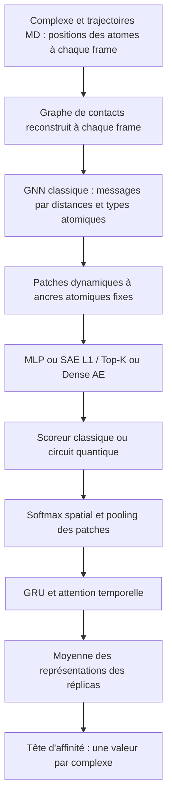
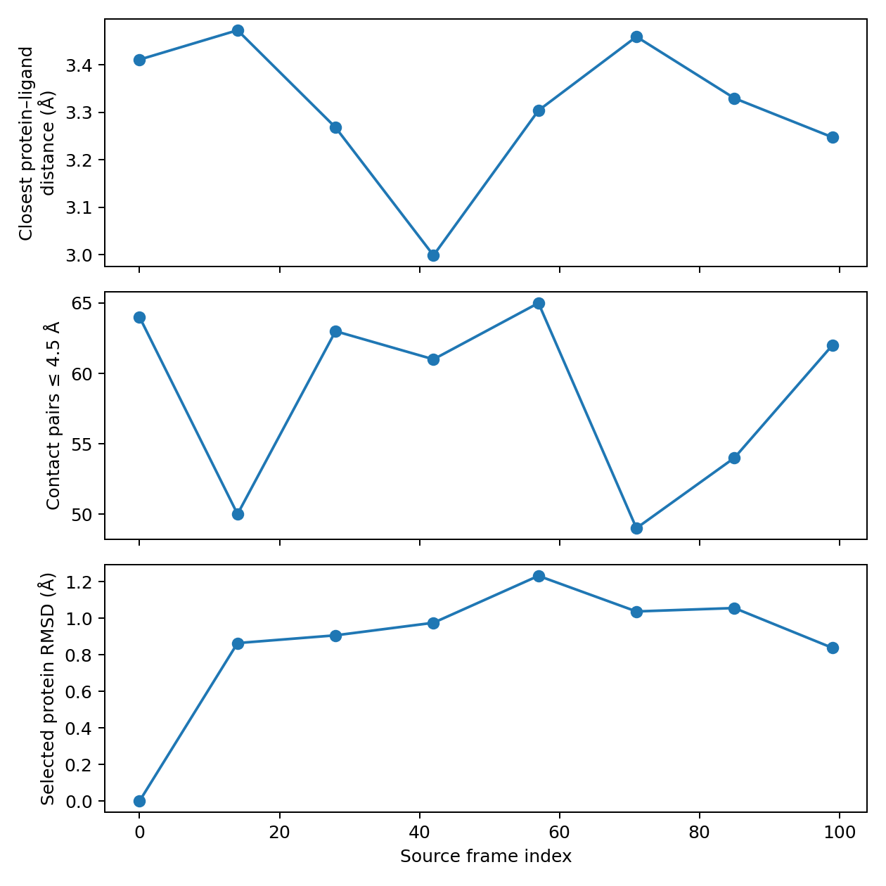

# Protein-Legand-Dynamique

Projet PyTorch pour l'affinité protéine–ligand à partir de **vraies trajectoires
MD**, avec GNN spatial, Sparse Autoencoder, scoring quantique PennyLane et
agrégation temporelle. Il réutilise la base SAE existante dans un nouveau dépôt :
`proteine-legand` et `Protein-Legand-Spase-Autoencoder` restent inchangés.

**Un petit dataset réel est inclus et prêt à lancer** : 12 complexes MISATO avec
Kd expérimentaux exacts, 8 snapshots ordonnés par complexe. Ce n'est pas le
benchmark complet, ni un résultat scientifique de performance.

## Démarrer immédiatement

Python 3.12/Linux/CPU sont les versions testées. Aucun modèle Hugging Face n'est
nécessaire pour la variante structurale par défaut.

```bash
git clone https://github.com/AnesMaria/Protein-Legand-Dynamique.git
cd Protein-Legand-Dynamique
python3 -m venv .venv
source .venv/bin/activate
python -m pip install --index-url https://download.pytorch.org/whl/cpu 'torch==2.5.1'
python -m pip install -r requirements-md.txt -c requirements-dynamic-cpu.lock
python -m pip check
export OMP_NUM_THREADS=2
python -m pytest -q

# Première vérification sur le petit MISATO inclus
python train_dynamic.py --projector mlp --model classical --epochs 2
python train_dynamic.py --projector sae --model quantum --epochs 2
python evaluate_dynamic.py --checkpoint runs/dynamic/sae_l1_quantum_gru/random/seed_0/best.pt
```

Un dossier de run existant n'est jamais écrasé ; utiliser `--output runs/mon_essai`
pour une autre exécution. Dans le cloud courant, les dépendances sont déjà
installées dans `/workspace/.venvs/proteine-legand` ; activer ce venv puis
travailler dans `/workspace/Protein-Legand-Dynamique`. Pour un venv indépendant :
`bash scripts/setup_dynamic_cloud.sh`, puis activer `/workspace/.venvs/protein-dynamic`.

Pour CUDA, installer PyTorch depuis l'index CUDA approprié (par exemple
`https://download.pytorch.org/whl/cu121` pour un pilote compatible), puis
`requirements-md.txt` **sans le verrou CPU**. `device: auto` choisit CUDA pour
PyTorch ; le simulateur quantique reste CPU. La voie CUDA n'a pas été testée ici.

## Pipeline spatio-temporel



La partie quantique est **le scoring des patches** ; les messages GNN et le GRU
restent classiques. Le circuit `default.qubit`/TorchLayer est repris du projet
SAE. Cette architecture ne prétend pas reproduire un modèle publié de Fadoua,
MISATO ou MDbind dont les paramètres complets ne sont pas connus.

Choix de baseline, configurables dans `dynamic_config.yaml` :

- Graphe de rayon 5 Å, reconstruit à chaque frame, arêtes dans les deux sens.
  Les features sont le numéro atomique, le rôle protéine/ligand, la proximité
  du partenaire et 16 RBF de distances pour les messages. Deux couches de
  message passing de dimension 64, implémentées directement en PyTorch.
  Ce graphe de proximité ne remplace pas une topologie de liaisons chimiques.
- Patches : 8 ancres FPS sur les atomes protéiques de référence, rayon 8 Å.
  Chaque ancre suit **le même atome** au cours du temps ; ses voisins et les
  contacts avec le ligand changent. Représentation fixe de dimension 256.
- SAE : latent 64, hidden 128, ReLU commune au contrôle Dense AE ; L1 moyenne
  des normes par patch ou masque Top-K=8. Projection légère vers 4 qubits.
- Quantique : 2 couches variationnelles, encodage RY, anneau CNOT, Pauli-Z,
  mesures analytiques sans shots. Le pooling spatial porte sur les patches
  d'origine, comme dans la baseline statique.
- Chaque frame fournit le patch pooling et la représentation structurale du
  ligand. GRU de dimension 128 avec attention temporelle, puis moyenne des
  réplicas et MLP scalaire. Un complexe fournit **une loss**, quel que soit
  le nombre de réplicas.
- Contrôles temporels : `gru`, `mean` (sans features d'ordre), `first` (une seule
  frame traitée). Les références atomiques restent fixes dans ces comparaisons.
  Le contrôle mean est invariant à une permutation des frames quand la
  référence de patches est conservée.

Les anciennes variantes statiques restent accessibles avec `train.py`,
`evaluate.py`, `pretrain_sae.py` et `config.yaml` : voir [STATIC_SAE.md](STATIC_SAE.md).
Les modules SAE, circuit quantique, métriques et encodeurs PLM ont été réutilisés.

## Dataset réellement inclus

[`examples/misato_kd_tiny/`](examples/misato_kd_tiny/) contient les NPZ, un CSV,
la provenance, les notices/licences sources et un diagnostic du complexe 184L.

Sources vérifiées :

- [MISATO](https://github.com/t7morgen/misato-dataset), commit
  `7b06d532e2ed0719411fcc1b3ac39743db4ca10d` :
  `data/MD/h5_files/tiny_md.hdf5`, 20 complexes, 100 frames par complexe.
- [MISATO-affinity](https://github.com/kierandidi/misato-affinity), commit
  `d03e0e84ce0e73512dbc2f7741e7f36537874745` :
  `data/affinity_data.h5`, avec unités, type de mesure et relation de censure.

Le loader utilise `trajectory_coordinates [T,N,3]`, `atoms_number` (numéros
atomiques) et `molecules_begin_atom_index` : la dernière molécule est le ligand
selon la convention MISATO inspectée. `atoms_element` est un code de mapping,
il n'est pas traité à tort comme un numéro atomique.

Les 12 complexes retenus ont un **Kd positif exact**, relation `=`.
`pKd = 9 - log10(Kd_nM)`. Les Ki, IC50 et labels manquants sont exclus de cette
cohorte. MMGBSA, énergie d'interaction, RMSD et SASA ne servent pas de labels
expérimentaux d'affinité et ne sont pas injectés comme features de substitution.
Un autre endpoint peut être préparé séparément avec `--endpoint Ki` ou `IC50`.
Le loader refuse de mélanger plusieurs endpoints.

Prétraitement du petit échantillon : 8 snapshots uniformes parmi 100,
coordonnées float32 en Å, hydrogènes retirés, au plus 64 atomes protéiques
proches du ligand, **tous les atomes lourds du ligand conservés**. Le sous-ensemble
atomique reste identique sur toute la trajectoire. Le crop s'appuie sur l'union
des contacts des frames sélectionnées ; on ne crée pas artificiellement une
trajectoire à partir d'une structure statique.

L'HDF5 n'expose pas les timestamps physiques des snapshots : les indices
`0,14,28,42,57,71,85,99` sont conservés, sans inventer de ns. La simulation source
est décrite comme 10 ns, mais son calendrier exact de snapshots après
équilibration ne se déduit pas simplement de ce nombre. Le GRU exploite l'ordre
et les écarts relatifs ; cette baseline ne prédit pas des constantes cinétiques.



Le RMSD affiché concerne les **atomes lourds protéiques sélectionnés**, après
alignement de Kabsch, pas un RMSD de toute la protéine. Les contacts sont ceux
du crop ; une limitation à 64 atomes peut omettre des contacts supplémentaires.

## Préparer davantage de MISATO

Reproduire la préparation depuis les sources épinglées :

```bash
python scripts/fetch_misato_example.py
python prepare_md.py \
  --md-h5 data/raw/MISATO/data/MD/h5_files/tiny_md.hdf5 \
  --labels-h5 data/raw/misato-affinity/data/affinity_data.h5 \
  --max-frames 16 --max-protein-atoms 128 --output data/dynamic/misato
python train_dynamic.py --manifest data/dynamic/misato/manifest.csv --projector sae --model quantum
```

Le fetch télécharge les petits dépôts sources, **pas** l'archive MD complète.
MISATO annonce environ 133 GiB pour celle-ci, disponibles via
[Zenodo 7711953](https://zenodo.org/record/7711953). L'espace de cette machine
ne permet pas d'y stocker l'archive complète. Avec un HDF5 déjà disponible sur
un stockage adapté, fournir son chemin à `--md-h5`. La conversion lit les
groupes et frames sélectionnés, pas tout le HDF5 en mémoire.

Si les véritables timestamps sont connus, `--dt-ps` enregistre un intervalle
explicitement fourni. Sinon, conserver `frame_index`. Les flags et crops sont
sauvegardés en provenance. Les coordonnées MISATO sont utilisées telles que
fournies ; aucune correction PBC supplémentaire n'est inventée.

## MDbind et PLAS-20k

Le même pipeline peut recevoir leurs **trajectoires natives** et les labels
expérimentaux associés, via l'importeur MDAnalysis. Il n'y a pas de prétention
à un téléchargement/converter natif vérifié de tous leurs fichiers : le layout
exact du benchmark MDbind cité dans votre demande n'a pas pu être vérifié ici.
Un dépôt homonyme MDBind de prédiction de sites n'a pas été utilisé comme s'il
s'agissait du dataset d'affinité de 63 000 simulations.

Le dépôt [PL-Affinity-PLAS-20k](https://github.com/devalab/PL-Affinity-PLAS-20k)
confirme l'usage de conformations MD et d'agrégations par complexe, mais ses
fichiers de conformères seuls ne suffisent pas à reconstruire sans métadonnées
l'ordre des frames et la séparation des réplicas. Utiliser les trajectoires/
topologies du fournisseur, en conservant ces informations.

CSV d'entrée pour l'importeur :

```text
complex_id,trajectory_id,protein_id,ligand_id,protein_group,ligand_group,topology,trajectory,affinity,target_type
c1,c1_rep0,P1,L1,P1,L1,c1/top.pdb,c1/rep0.xtc,7.1,pKd
c1,c1_rep1,P1,L1,P1,L1,c1/top.pdb,c1/rep1.xtc,7.1,pKd
```

Cet exemple de schéma n'est pas un label d'affinité inventé pour un complexe réel.
Les chemins sont relatifs au CSV. `affinity` doit contenir le pKd/pKi/pIC50
expérimental choisi ; ne pas appeler pKd une énergie en kcal/mol.

```bash
python scripts/export_md_trajectory.py --input paths.csv --dataset mdbind \
  --ligand-selection 'resname LIG' --output data/dynamic/mdbind
python prepare_md.py --source canonical --manifest data/dynamic/mdbind/manifest.csv
python train_dynamic.py --manifest data/dynamic/mdbind/manifest.csv --projector sae --model quantum
```

Utiliser `--dataset plas20k` pour PLAS. Les lecteurs prennent en charge les
formats MDAnalysis adaptés à leurs topologies (XTC/DCD/NetCDF, etc.). Les
éléments atomiques doivent être explicitement présents ; le code n'en devine
pas le sens à partir de noms ambigus. Une structure PDB/SDF/MOL2 isolée n'est pas
acceptée comme trajectoire MD. ATLAS apo seul n'est pas un dataset d'affinité
protéine–ligand pour ce loader : il manque ligand et labels associés.

PBC : `--unwrap` nécessite les liaisons et les boîtes ; il rend les fragments
liés entiers et place le ligand dans l'image la plus proche de la protéine.
Pour des protéines multichaînes/systèmes fragmentés, vérifier en amont
l'assemblage des images et les sélections. Sans ce flag, utiliser des coordonnées
déjà correctement préparées. `--physical-time` n'est à employer que lorsque
le dt/time lu par MDAnalysis est réellement documenté ; certains lecteurs
peuvent fournir une valeur par défaut. Sinon les indices de frames sont utilisés.

## Format canonique et splits

Chaque NPZ contient :

| Champ | Forme / convention |
|---|---|
| `positions` | `[T>=2,N,3]`, Å, ordre atomique fixe |
| `atomic_numbers` | entiers `[N]`, 1 à 118 |
| `ligand_mask` | booléens `[N]`, protéine et ligand non vides |
| `atom_ids` | indices originaux uniques `[N]` |
| `reference_positions` | `[N,3]`, référence fixe pour les ancres |
| `time`, `frame_indices` | `[T]`, strictement croissants |
| `units`, `time_unit` | `angstrom`, et `ps`/`ns`/`frame_index` |

Un CSV associe trajectoires, réplicas, complexes, identités, endpoint et label.
Les réplicas d'un complexe doivent avoir le même label et les mêmes métadonnées.
Ils sont chargés ensemble et moyennés au niveau des représentations temporelles,
avant la prédiction finale. Une trajectoire référencée plusieurs fois est refusée.

Les splits se font **par complexe**, en groupant les alias protéine/ligand.
Frames et réplicas ne passent jamais d'une partition à l'autre. Les variantes
`random`, `cold_protein`, `cold_ligand`, `cold_both` sont disponibles. Les modes
froids nécessitent une séquence ou un `protein_group` stable, ainsi qu'un SMILES
ou un `ligand_group` fiable pour les ligands. Les peptides nommés `4-mer` dans
le petit MISATO ne suffisent pas : cold-ligand/both est refusé tant que leur
identité chimique n'est pas complétée. Cold-Both exclut et compte les paires
entre partitions ; un split vide provoque une erreur, pas un changement silencieux
de seed.

Les fractions concernent les groupes et ne garantissent pas les mêmes fractions
de complexes. Le petit échantillon donne **10 train / 1 val / 1 test** en random
seed 0. Ses corrélations/CI de test sont donc indéfinis (`null`). Il ne doit pas
servir à conclure à un gain du SAE ou du quantique.

## ESM-2 et ChemBERTa optionnels

Pour la baseline dynamique incluse, les embeddings sont ceux du GNN atomique.
Les vrais séquences/SMILES ne sont pas fournis par les HDF5 utilisés ; ils ne
sont pas inventés à partir des ID de ligands. Pour les ajouter, compléter le
manifest avec `sequence`/`smiles` (ou `prepare_md.py --metadata metadata.json`),
puis mettre `dynamic.language_context: true`. Le modèle concatène les moyennes
ESM-2 et ChemBERTa à la représentation temporelle du complexe. Les encodeurs,
caches et révisions épinglées sont repris de la baseline. Aucun alignement
résidu–atome fictif n'est créé. Sans métadonnées réelles, ce mode échoue clairement.

## Pré-entraînement SAE et ablations

```bash
python pretrain_dynamic_sae.py --epochs 30 --output runs/md_pretrain_l1
python train_dynamic.py --projector sae --model quantum \
  --sae-checkpoint runs/md_pretrain_l1/best.pt
python train_dynamic.py --projector sae --model quantum \
  --sae-checkpoint runs/md_pretrain_l1/best.pt --freeze-sae --freeze-graph \
  --output runs/md_frozen
```

Le pré-entraînement utilise uniquement les complexes du train d'affinité, avec
validation interne disjointe par groupes. L'encodeur spatial est figé et ses
poids sont sauvegardés avec le SAE, pour préserver le sens des patches.
Par défaut il est à son initialisation seedée ; `--graph-checkpoint` permet
de partir d'un encodeur spatial déjà entraîné sur **ce même train**. Le chargement
refuse un autre split, seed, ensemble train, contenu MD ou configuration spatiale.
Un checkpoint SAE statique n'est pas un SAE dynamique compatible.

Pour une baseline contrôlée avec le même graphe figé :

```bash
python train_dynamic.py --projector mlp --model quantum --freeze-graph \
  --graph-checkpoint runs/md_pretrain_l1/best.pt --output runs/md_shared_graph_mlp
```

Loss jointe : `MSE_affinité + alpha*MSE_reconstruction + beta*L1`.
Pré-entraînement : `MSE_reconstruction + lambda_sparse*L1`.
Top-K impose son masque sans L1 additionnelle ; Dense AE conserve la même
architecture mais sans masque/pénalité. Les paramètres sont configurables et
les diagnostics surveillent le collapse des latents.

```bash
python train_dynamic.py --projector mlp --model quantum
python train_dynamic.py --projector sae --model classical
python train_dynamic.py --projector sae --model quantum
python train_dynamic.py --projector sae --sparsity-mode topk --model quantum
python train_dynamic.py --projector dense_ae --model quantum

# Importance de l'ordre temporel et contrôle à une seule frame
python train_dynamic.py --projector sae --model quantum --temporal mean
python train_dynamic.py --projector sae --model quantum --temporal first

# Matrice et mean ± sample std, seeds 0 à 4
python scripts/run_dynamic_experiments.py --seeds 0 1 2 3 4 --include-topk
python scripts/run_dynamic_experiments.py --seeds 0 1 2 3 4 \
  --temporal gru mean first --include-topk --dry-run
```

Le runner effectue le mode joint, sans autocharger des poids pré-entraînés.
Pour les autres datasets, fournir `--manifest` et choisir une racine
`training.output` propre dans une config dédiée. Pour les splits froids sur des
identités complètes : `--splits cold_protein cold_ligand cold_both`.
Le dry-run n'exécute ni entraînement ni résultats. Les variantes sont séparées
par nom, mode temporel, split et seed ; l'agrégation refuse des configs/protocoles
ou sources différentes.

## Artefacts et diagnostics

Chaque run conserve config, environnement, splits, meilleur checkpoint,
historique, prédictions **par complexe**, RMSE/MAE/Pearson/Spearman/CI, nombre de
paramètres entraînables et timings. La normalisation des labels est ajustée
sur le train uniquement ; le meilleur checkpoint est choisi sur la MSE d'affinité
validation. Les temps incluent les passes train/validation, pas le chargement
initial ni le pré-entraînement ; comparer hors concurrence et avec des caches prêts.

Les NPZ de latents indexent `complex_id`, `trajectory_id`, `frame_index`,
`patch_index`, `anchor_atom_id` et l'attention spatiale. Les JSON temporels
donnent les poids par frame et unité temporelle. Pas de patches/frame de padding.

```bash
python scripts/analyze_dynamic_latents.py \
  --input runs/dynamic/sae_l1_quantum_gru/random/seed_0/latents_test.npz
python scripts/analyze_trajectory.py \
  --trajectory examples/misato_kd_tiny/trajectories/184L_r0.npz --plot
```

La structure principale ajoutée est `src/dynamic/{data,prepare,graph,model,engine,pretrain}.py`,
avec `prepare_md.py`, `train_dynamic.py`, `evaluate_dynamic.py`,
`pretrain_dynamic_sae.py` et les scripts d'import, matrice et analyse.
Voir [VALIDATION.md](VALIDATION.md) pour les tests réellement exécutés et les
limites. Les données complètes MDbind/PLAS/MISATO, cinq seeds complets et CUDA
restent à valider ; aucun résultat de benchmark n'est fabriqué.
